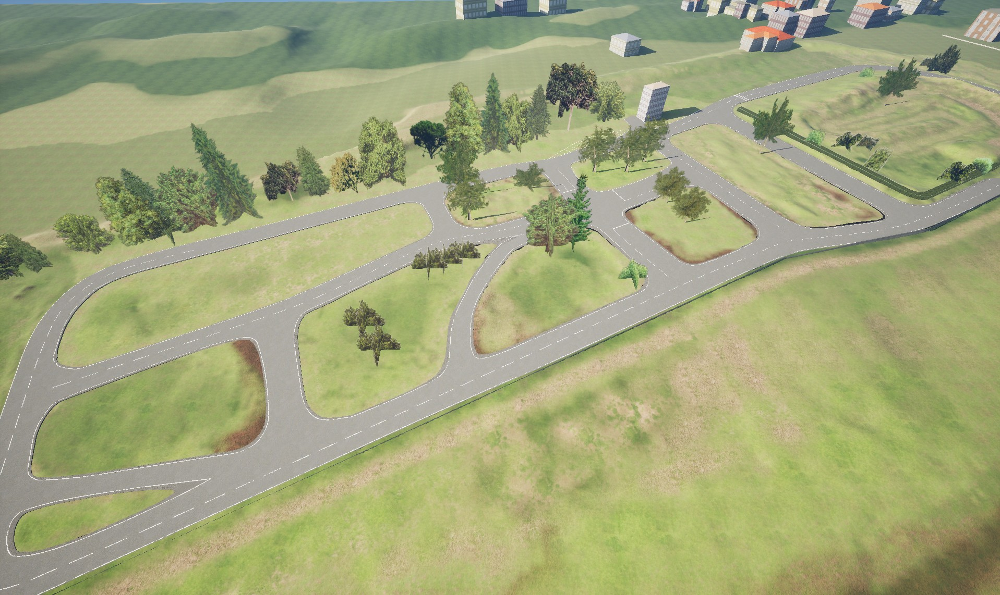

# GEMSTAR UE_Driving_Practise_Area_Map_Feature

[](https://www.dlr.de/en/ts/about-us/the-institute-of-transportation-systems)

3D map of the driving practise area in brunswick for the use in GEMSTAR. Take a look at it in [OpenStreetMap](https://www.openstreetmap.org/#map=18/52.323042/10.549595).



# Getting started

First clone the GEMSTAR Interfaces plugin inside Plugins and the ue_driving_practise_area_map_feature inside Plugins/GameFeatures.

Add the plugin to your Unreal project:
```sh
mkdir Plugins/GameFeatures
cd Plugins/GameFeatures

git clone https://github.com/DLR-TS/ue_driving_practise_area_map_feature.git
```
or:
```sh
git submodule add https://github.com/DLR-TS/ue_driving_practise_area_map_feature.git
```

---------------
**Contact:** opensource-ts@dlr.de
